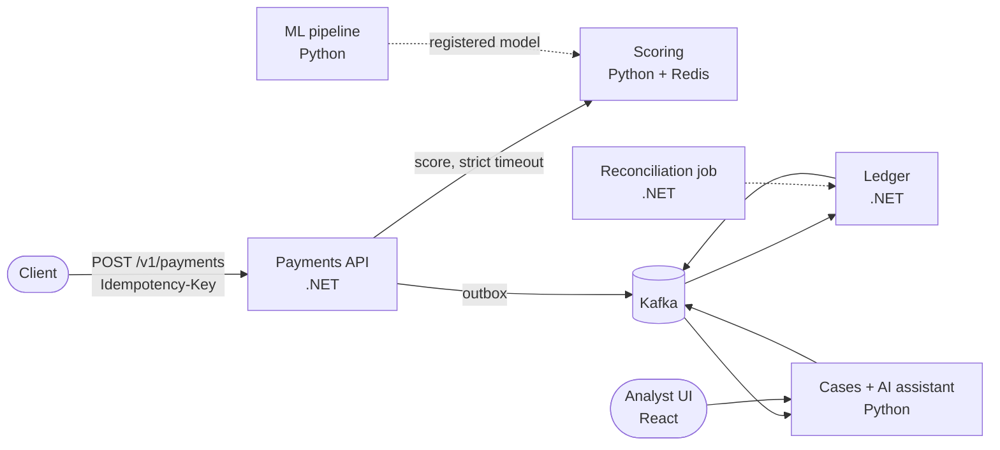

# Sentinel

A real-time decisioning platform, built from event-driven services, an ML
scoring pipeline and an LLM-assisted review workflow, applied to payments fraud.

[](https://github.com/LehakoeThinane/Sentinel/actions/workflows/ci.yml)

> Portfolio project. All data is synthetic, and none of it is production-ready.

## What it does

Every payment is scored for fraud risk as it arrives. Accepted payments are
posted to a double-entry ledger that never loses or creates money. Payments
that look risky are held for a human analyst, who gets an AI-drafted summary
built only from the case's own records. The assistant can read; it can never
approve, decline or move money.

## Architecture



Only the Payments API sits on the request path. It enforces idempotency, asks
the scoring service for a risk score, applies thresholds and records its
decision together with an outbound event in one database transaction. Every
other component reacts to events: the ledger posts approved payments, the
case service opens reviews for held ones, and a nightly job reconciles the
ledger against a simulated settlement file.

The transactional services are C#/.NET; the ML and AI services are Python.
They share language-neutral contracts in [`contracts/`](contracts/): an
OpenAPI spec for the HTTP API and JSON Schemas for every event. Each service
owns its own PostgreSQL schema and database role, and no service reads
another's data.

Rules that hold everywhere:

- Money is an integer number of minor units (cents) plus a currency code. Never floating point.
- Ledger entries are insert-only, and every transaction balances.
- `POST /v1/payments` requires an `Idempotency-Key`; a retry never charges twice.
- Events are delivered at least once, so every consumer is idempotent.

## Run it locally

You need Docker, the .NET 10 SDK, Python 3.12 and GNU make.

```sh
# Start PostgreSQL, Redis, Kafka and the services; returns when all are healthy
make up

# Developer tooling
uv venv --python 3.12 && uv pip install -r requirements-dev.txt -r tests/e2e/requirements.txt
pre-commit install

make test   # guardrail, .NET, contract and Python unit tests
make e2e    # end-to-end round trip against the running stack
make lint   # ruff and dotnet format
make down
```

Without make, use `docker compose -f infra/local/docker-compose.yml up -d --wait`
and run the commands in the [`Makefile`](Makefile) directly. Local
credentials default to development-only placeholders; copy `.env.example` to
`.env` to override them.

Try the walking skeleton:

```sh
curl -i http://127.0.0.1:8080/v1/payments \
  -H 'Content-Type: application/json' \
  -H 'X-Client-Id: demo' -H 'Idempotency-Key: demo-1' \
  -d '{"payer_account_id":"0192f3a4-0000-7000-8000-000000000001",
       "payee_account_id":"0192f3a4-0000-7000-8000-000000000900",
       "amount_minor":25000,"currency":"ZAR","channel":"app"}'
```

## Repository layout

| Path | Contents |
| --- | --- |
| `services/payments-api` | Payments API (.NET) |
| `services/ledger` | Double-entry ledger (.NET) |
| `services/reconciliation` | Settlement reconciliation job (.NET) |
| `services/scoring` | Real-time fraud scoring (Python) |
| `services/cases-assistant` | Case workflow and read-only AI assistant (Python) |
| `ml/` | Training, evaluation and drift monitoring |
| `ui/analyst` | Analyst UI (React + TypeScript) |
| `contracts/` | OpenAPI and event JSON Schemas, with validation tests |
| `infra/local` | docker-compose stack |
| `infra/terraform` | Azure infrastructure (later phase) |
| `tests/` | End-to-end, load and guardrail tests |

## How AI-assisted development is controlled

Parts of this codebase are written with a coding agent, under explicit,
committed controls:

- [`CLAUDE.md`](CLAUDE.md) states the rules the agent must follow.
- [`.claude/settings.json`](.claude/settings.json) hard-denies risky commands
  (force-push, force-add, destructive resets, cloud CLIs) and requires a human
  prompt before commits, pushes, new dependencies and edits to CI,
  infrastructure, migrations or the rules themselves.
- [`.claude/hooks/`](.claude/hooks/) check every shell command and every file
  edit, for example flagging floating-point types in money code. Their tests
  live in [`tests/guardrails/`](tests/guardrails/).
- Pre-commit hooks and CI add secret scanning, formatting and lint checks,
  and every change reaches `main` through review.

## Roadmap

| Phase | Scope | Status |
| --- | --- | --- |
| 0. Foundations | Repository, contracts, local stack, walking skeleton, CI, guardrails | Done |
| 1. Ledger and payments API | Idempotency, double-entry ledger, concurrency control, audit trail | Next |
| 2. Events and scoring | Transactional outbox, first fraud model, thresholds, scorer-outage behaviour | Planned |
| 3. MLOps and observability | Model registry, drift monitoring, tracing, dashboards, load tests | Planned |
| 4. Cases, AI assistant and UI | Case workflow, grounded assistant with an evaluation set, reconciliation, analyst UI | Planned |
| 5. Azure | Infrastructure as code, managed identities, deployment pipeline | Planned |

## Data and limitations

- All data is synthetic or comes from public datasets; no real customer data
  is used anywhere. Raw datasets are never committed.
- This is a portfolio project. It makes no claim of production readiness and
  is not connected to any bank, card scheme or real money.
- Performance figures, once published, describe a local reference environment
  only.
